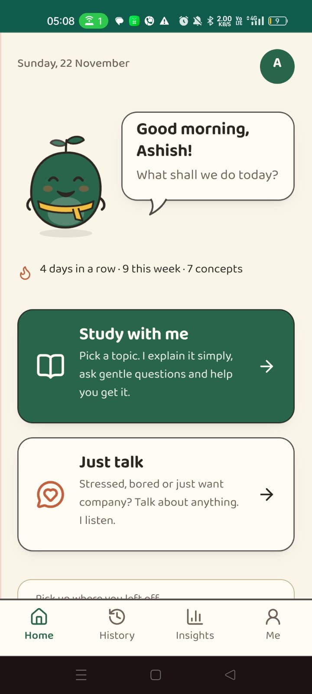
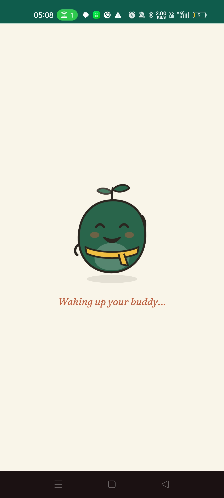
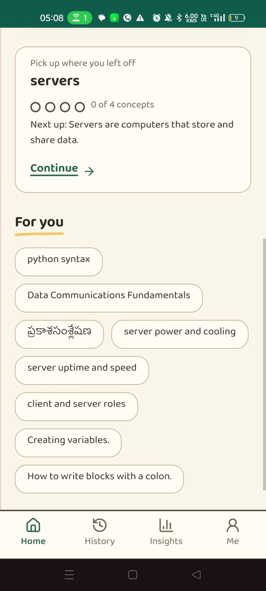
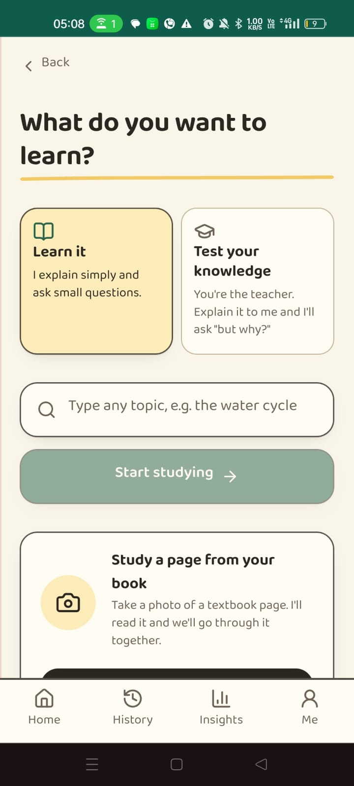
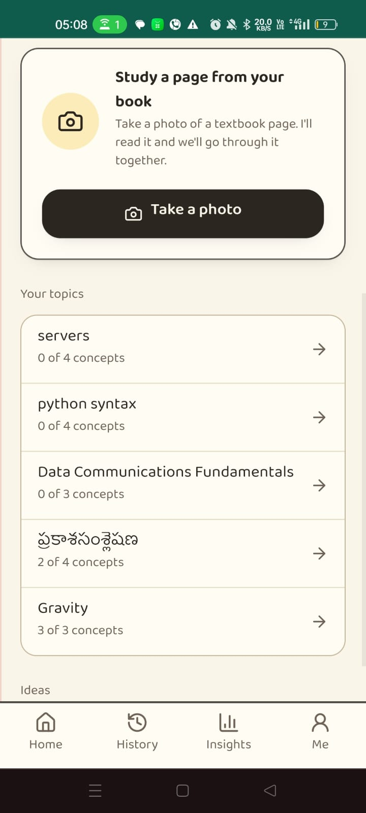
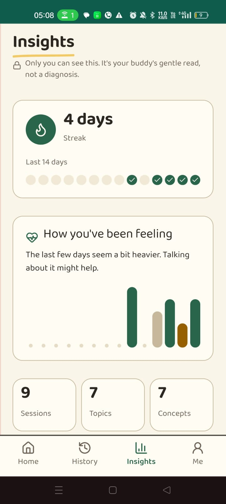
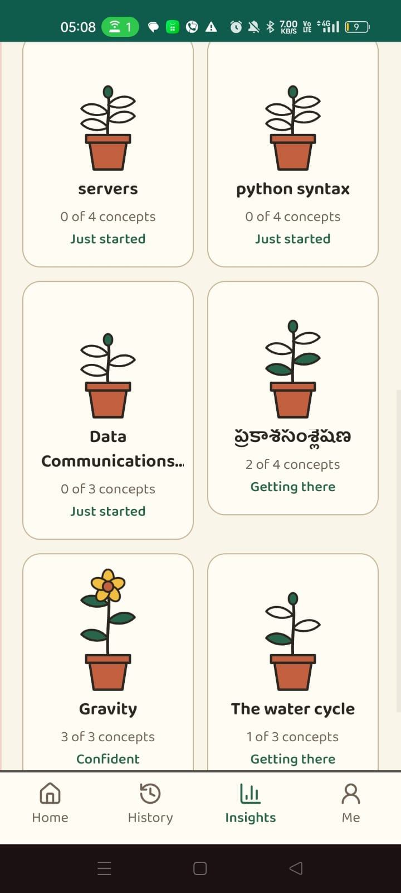
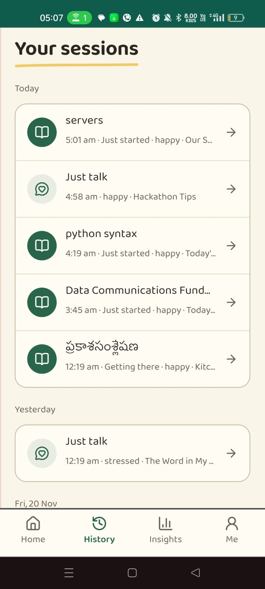
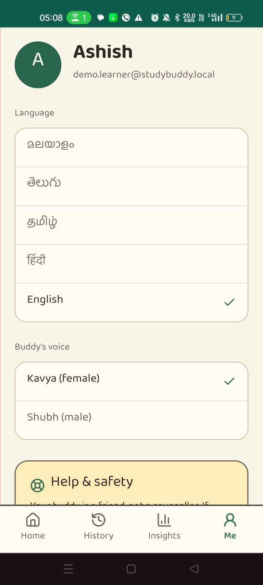
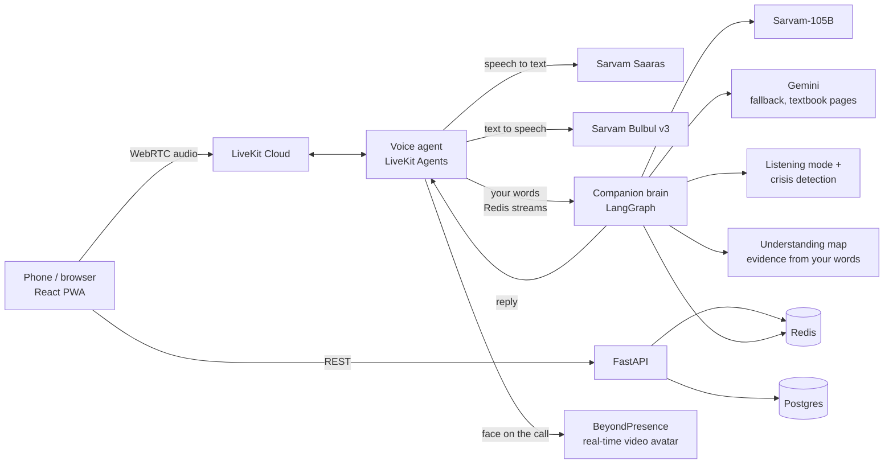

# WithYou

**A companion you can see, hear and talk to face to face, in your own language.**
You open WithYou and you're on a video call with someone who looks at you, listens, and answers in Malayalam, Telugu, Tamil, Hindi or English. It talks with you when the day is heavy, sits with you when you study, remembers how you've been, and notices, quietly, when you're not okay.

Malayalam · Telugu · Tamil · Hindi · English &nbsp;|&nbsp; Live: **https://13.205.190.12.sslip.io** &nbsp;|&nbsp; Demo login: `demo.learner@studybuddy.local` / `demo-password-123`

---

## Some nights, there's no one to tell

It's late. The house is asleep. A seventeen-year-old lies awake with a feeling she can't name: part exam fear, part a fight with a friend, part the sense that everyone else has it figured out. She won't wake her parents; they're tired, and they'd worry. Her friends are asleep or pretending everything's fine. Typing it into a search box feels absurd. And even if she found someone to talk to, the words for what she feels come to her in Malayalam, not English.

Tomorrow she'll still have a chapter she doesn't understand and a test she's dreading. But tonight what she needs is simpler: someone who answers when she talks, in the language she feels in, who doesn't judge, doesn't lecture, doesn't rush to fix her, and who'll still be there in the morning when she says *"okay, can you help me with this chapter?"*

That's WithYou. Not a chat window and not an app you open for one job: **a face across the table**, on a video call, that's with you through the whole of it, the studying and the stress and the ordinary days in between.

## Meet WithYou, face to face

This is what opening WithYou feels like: a video call with a real-looking person who greets you, listens, waits while you find your words, and talks back in your language with live captions underneath.

<p align="center">
  <a href="assets/withyou-demo.mp4"></a>
  <br>
  <b><a href="assets/withyou-demo.mp4">▶ Watch the 6-minute demo</a></b> (recorded on a phone, the whole app end to end)
</p>

<table>
  <tr>
    <td align="center" width="33%"><br><sub><b>Home.</b> Your companion greets you, remembers your streak, and offers two doors: study together, or just talk.</sub></td>
    <td align="center" width="33%"><br><sub><b>Just talking.</b> A face-to-face call with live captions. Switch between മല · తెలు · தமி · हिं · EN at any moment.</sub></td>
    <td align="center" width="33%"><br><sub><b>Without the video face,</b> an animated companion whose expression shows it's listening, thinking or speaking.</sub></td>
  </tr>
  <tr>
    <td align="center"><br><sub><b>It remembers.</b> Pick up where you left off, and suggestions drawn from <i>your</i> past conversations.</sub></td>
    <td align="center"><br><sub><b>Learn your way.</b> Have it explained, or flip roles and teach it: "Test your knowledge".</sub></td>
    <td align="center"><br><sub><b>Your own textbook.</b> Photograph a page and go through exactly that page together.</sub></td>
  </tr>
  <tr>
    <td align="center"><br><sub><b>It notices.</b> "The last few days seem a bit heavier." A private, gentle read of how you've been; never a diagnosis.</sub></td>
    <td align="center"><br><sub><b>Growing, not grading.</b> A plant for each topic, a leaf for each idea you've understood, a flower when you know it all.</sub></td>
    <td align="center"><br><sub><b>Your story so far.</b> Every conversation, with how you felt. Private "just talk" content never appears here.</sub></td>
  </tr>
  <tr>
    <td align="center"><br><sub><b>Your language, your voice.</b> Five languages and two voices; the whole app follows.</sub></td>
    <td colspan="2" valign="middle"><sub>All screenshots are from the live app on an ordinary Android phone. The demo account in them is real data from testing: a week of study sessions and "just talk" conversations in English and Telugu.</sub></td>
  </tr>
</table>

## Why this is needed

- **Young Indians are carrying a lot, quietly.** India's National Crime Records Bureau (ADSI 2022) recorded over 13,000 student suicides in one year, more than 35 every day. Behind that number are millions more who are anxious, lonely or overwhelmed and never say so out loud.
- **Feelings live in the mother tongue.** Most support (helplines, apps, chatbots) is built English-first. But people describe what hurts in the language they grew up with. A companion that can't speak it can't really listen.
- **Help is unequal.** Counselling, tuition and even a patient adult with time to spare are luxuries. The young people who need someone most are the least likely to have anyone.
- **Life doesn't come in separate apps.** The stress *is* the studying; the studying is harder *because* of the stress. A wellness app over here and a tutoring app over there don't see the whole person. A real companion does.

## What WithYou is

You open it and you're **on a video call**. A person's face looks back at you, nods along while you speak, and answers in a warm, natural voice in your own language, with live captions underneath. You talk out loud, the way you'd talk to someone who knows you, and it remembers.

That's the heart of WithYou: **it doesn't feel like using an app, it feels like talking to someone.** Text chatbots ask you to type your feelings into a box. WithYou gives you a face to talk to, which is what people actually reach for when they're struggling, and what makes learning stick when you're stuck.

### It listens when you just need to talk
Tap *"How are you feeling?"* (stressed, worried about exams, bored, tired, happy) or just start talking. WithYou becomes a listener: it doesn't steer you back to work, doesn't diagnose, doesn't hand you a list of tips. It asks what happened and waits for the answer. Informal, the way a friend speaks (നീ / నువ్వు / நீ / तुम, never the distant formal "you"), and it never pretends to be more than it is.

### It notices how you've been, without you filling in a form
After every conversation, WithYou makes a gentle read of how you seemed (calm, tired, stressed, low) from your own words. Over the days, your *Insights* page shows the shape of your week. If the last few days have been heavy, it says so softly and reminds you that you don't have to carry it alone. This is only for you; it's labelled as a companion's read, never a diagnosis, and it's never shared.

### It takes the dark moments seriously
If you ever talk about hurting yourself or not wanting to live, in any of the five languages, WithYou **detects it in code, not by hoping the AI notices**. It stops everything else, responds calmly and seriously, thanks you for telling it, asks if you're safe right now, and gives you **Tele-MANAS (14416, free, 24×7)** and **112**. It's honest that it's a companion, not a counsellor, and that a real person can help more. The helpline stays on your recap afterwards.

### It sits with you when you study
When you're ready, the same companion helps you learn, patiently, in your language:
- **Explains things the way a friend would**: simply, with an everyday example, English technical terms where people really use them.
- **Checks, gently, whether it actually made sense.** Every topic is broken into key concepts, and a concept only counts as understood when your own words show it. A vague answer gets one kind follow-up, never a drill.
- **Lets you teach it.** In *Test your knowledge*, it becomes the curious one who doesn't know the topic: it asks "but why?", and sometimes gets something a little wrong so you can correct it.
- **Reads your own textbook.** Photograph the page you're stuck on; in about two seconds it tells you what it's about and goes through *that* page with you.

### It remembers, and grows with you
Every conversation adds to a shared history: what you talked about, what clicked, what to come back to. Home greets you with where you left off and suggestions from *your* past, not a generic feed. What you've learnt grows into a small **garden** (a plant for each topic, a leaf for each idea you understood, a flower when you've got the whole thing). A streak, a mood line, a short kind recap after each conversation. No marks, no ranks, no red crosses.

### It speaks your language, and changes when you do
Malayalam, Telugu, Tamil, Hindi and English, in voice, on screen and in your history. Say *"தமிழ்ல சொல்லு"* or *"हिंदी में बोलो"* mid-conversation, or tap a button, and it switches both how it speaks and how it listens. Past conversations are shown in whichever language you're using today.

## Not another friend bot

Plenty of apps will chat with you. A companion is something else: it has **memory, boundaries and judgement**.

| A typical AI "friend" chatbot | WithYou |
|---|---|
| A text box, English-first | **A face-to-face video call**: a human face, a real voice, live captions, in five Indian languages |
| Forgets you when the chat ends | **Remembers**: your history, how you've been feeling, what you're working on |
| Agrees with everything, keeps you hooked | Honest and bounded: says it's not a counsellor, points you to real people |
| Safety depends on the model's mood | **Deterministic crisis detection** in every language, with real Indian helplines |
| Only talks | Also **helps you do things**: learn, revise, understand your own textbook |
| Tracks you for engagement | Your feelings are **private to you**; "just talk" conversations never appear on history cards |
| Same answers for everyone | Built around *you*: your language, your syllabus, your pace, your week |

## Designed around real people

- **It waits for you.** People pause when something is hard to say. WithYou waits longer before replying, never talks over you, and after a long silence asks gently instead of moving on.
- **It hears you correctly.** Automatic language detection misheard Telugu as Kannada in real testing, so listening is locked to your language and switched only when you ask.
- **It answers quickly.** Replies are sent as soon as they're ready; anything slower (like updating what you've understood) happens afterwards, so a conversation never stalls.
- **It works on the phone you have.** Installable from the browser, mobile-first, no app store.
- **It looks you in the eye.** WithYou appears as a person on a video call (a lifelike real-time avatar, lip-synced to its voice), with live captions so you can follow every word. If the video service is ever unavailable, the call carries on with an animated companion whose face shows it's listening, thinking or speaking; it never just drops you.

## How it works



| Part | What it does | Code |
|---|---|---|
| **Video-call agent** | Joins the call as the companion: brings the lifelike video face (BeyondPresence), listens (Saaras) and speaks (Bulbul), follows language switches, gentle silence nudges, falls back to the animated companion if video fails | `avatar/agents/` |
| **Companion brain** | Understands each turn, chooses how to respond (listen, chat, explain, check, coach, be taught), writes the reply, then updates its memory; writes the recap with a mood read | `worker/brain/` |
| **Listening + safety** | The "just talk" persona; crisis phrases in five languages and the safety response that overrides everything | `worker/brain/talk.py` |
| **Understanding map** | Key concepts of a topic, assessed only with quoted evidence from the learner | `worker/brain/understanding.py` |
| **API** | Accounts, history, insights (streak, mood timeline, learning levels), personal suggestions, translation of past conversations into today's language, textbook-page reading | `avatar/api/` |
| **App** | Home (talk or study), Learn, live conversation, recap, History, Insights, Profile, in five languages | `frontend/src/features/` |

**Stack:** Python, FastAPI, LangGraph, LiveKit Agents, Redis Streams, PostgreSQL + Alembic, React 18 + TypeScript + Vite + Tailwind. **AI:** Sarvam (Saaras STT, Bulbul v3 TTS, Sarvam-105B, Sarvam Translate) first, because it was built for Indian languages; Google Gemini as fallback and for reading textbook pages; BeyondPresence for the real-time video face.

### Decisions that matter

- **Safety is code, not a prompt.** Self-harm language is matched deterministically in all five languages before any model is involved, and the safety instruction outranks every other mode.
- **Honesty over engagement.** The companion is told, and built, to say what it is, to point to real people, and never to claim progress you haven't shown: a concept counts as understood only with your own words as evidence.
- **Your language is a rule, not a suggestion.** When asked to switch, models tend to *agree* to switch and then carry on in the old language, so switching is detected and applied before the model writes a word.
- **Privacy by design.** Talk conversations stay out of history cards; mood insights are visible only to you.
- **It degrades gently.** No avatar → voice. Main model down → fallback model. A bad translation → the original text. No model for the recap → a simple recap from memory.

## Try it

**Live:** https://13.205.190.12.sslip.io. Use a phone and allow the microphone. Sign in with `demo.learner@studybuddy.local` / `demo-password-123` (a week of conversations, moods and a garden) or create your own account.

**Two minutes with it:** choose your language on *Me*. On Home, tap a feeling like *"Worried about exams"* and just talk for a minute. Then go back, choose *Study with me*, and ask it to explain something; answer its question. End, read the recap, and open *Insights* to see how your week looks. Try *Learn → Study a page from your book* with any textbook page.

**Run it yourself:**

```bash
# Postgres + Redis (docker), then in four terminals:
cd worker  && uv sync && uv run python worker.py                  # companion brain
cd avatar  && uv sync && uv run python main.py                    # API on :8001
cd avatar  && uv run python -m agents.entrypoint dev              # voice agent
cd frontend && npm install && npm run dev                         # app on :3000
```

Keys go in `avatar/.env` and `worker/.env` (see the `.env.example` files): Sarvam, LiveKit and Google; BeyondPresence is optional. One-server production deploy (Docker + Caddy HTTPS): `deploy/buddy/deploy.sh <server-ip>`.

**Tests:** `cd worker && uv run pytest` (143) · `cd avatar && uv run pytest` (72): crisis detection in every language, language switching, the listening and teaching modes, understanding assessment, translation guards, the API.

## Honest limits, and what's next

- Tamil and Hindi wording, and the crisis phrases in every language, need review by native speakers before people rely on them; the safety phrases most of all.
- WithYou is a companion, not therapy. Its mood read is a gentle signal for you, deliberately not a clinical tool.
- **Next:** all 11 languages Sarvam supports; a gentle check-in when you've been quiet for a few days; a weekly note you can *choose* to share with someone you trust; more everyday help beyond studying (planning your day, preparing for a hard conversation).

## Why we built it

Everyone deserves someone who answers when they talk, in the language they feel in. Someone patient on the hard days, useful on the busy ones, and honest enough to say *"I'm here, and you should also talk to someone who can do more than I can."*

WithYou is built to be that someone. **With you, in your language, through all of it.**
