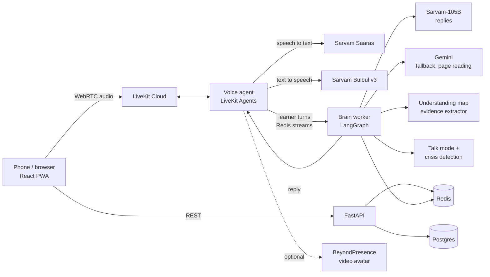

# WithYou · പഠിപ്പ് കൂട്ടുകാരൻ

**A voice study companion for Indian students who understand the world in their mother tongue but are taught in someone else's language. It teaches, checks what you've actually understood, and notices when you're not okay.**

Malayalam · Telugu · Tamil · Hindi · English &nbsp;|&nbsp; Live: **https://13.205.190.12.sslip.io** &nbsp;|&nbsp; Demo login: `demo.learner@studybuddy.local` / `demo-password-123`

---

## 9:40 pm, the night before the exam

A Class 10 student in Palakkad sits with her biology textbook open on the bed. The chapter is photosynthesis, written in English. She has read the same paragraph four times. She can recite "chlorophyll absorbs light energy", but if you asked her *why the leaf needs sunlight*, she couldn't tell you, and she knows it.

She can't ask her teacher at this hour. Tuition costs money her family is already stretched for. Her parents would help, but they studied in Malayalam, thirty years ago. A search engine gives her more English. A chatbot gives her a wall of text that sounds right and teaches her nothing.

What she needs is someone who will sit with her, explain it in the language she *thinks* in, ask her a small question to see if it landed, wait without judging when she gets it wrong, and, if she says *"I'm so tired of all this, I can't do it"*, stop teaching and listen.

That's what WithYou is.

## Why this matters

- **Most Indian children don't think in the language they're examined in.** Concepts are taught in English, but understanding forms in Malayalam, Telugu, Tamil, Hindi. The gap between *memorising* and *understanding* is often a language gap, and it's widest for first-generation learners who have no one at home to bridge it.
- **Help is unequal.** Private tuition is a large household expense in India. The students who most need patient, one-on-one explanation are the least likely to get it.
- **The pressure is real and it is dangerous.** India's National Crime Records Bureau (ADSI 2022) recorded over 13,000 student suicides in a single year: more than 35 every day. Exam stress is not a side issue to studying; for many students it *is* the experience of studying.

Most edtech treats these as separate problems: a tutoring app over here, a wellness app over there. A real study buddy doesn't. The friend who helps you with physics is the same friend who notices you've gone quiet.

## What WithYou does

You open the app and **talk**. Out loud, in your language, the way you'd talk to an older cousin who happens to be good at science.

### 1. It teaches the way a patient friend would, in your language
Pick any topic (or say it). The buddy explains it simply, with an everyday example ("plants cook their food the way we cook rice, but with sunlight"), keeps English technical terms where students actually use them, and speaks informally (നീ / నువ్వు / நீ / तुम, never the distant formal "you"). Switch language mid-conversation ("தமிழ்ல சொல்லு", "हिंदी में बोलो") or with one tap; the voice and the listening both follow.

### 2. It knows the difference between "I said the words" and "I understood"
This is not a chatbot that tells you you're doing great. Every topic is broken into its **key concepts**. When you answer, an evidence extractor checks your words against each concept and only marks it understood with a **direct quote** from you that shows it. A vague answer gets *one* gentle follow-up question; if you're still stuck, it explains again, kindly, instead of drilling. The "Learning level" you see (*just started → getting there → confident*) comes from this evidence, not from how long you talked.

### 3. "Test your knowledge": you become the teacher
The best way to learn something is to explain it. In this mode the roles flip: the buddy becomes a curious younger student who knows nothing about the topic. It asks "but *why*?", asks for an example, and sometimes confidently gets something slightly wrong ("so plants eat soil, right?") so that *you* have to correct it. Every concept you explain well turns green.

### 4. Photograph a page of your own textbook
Point your phone at the actual page you're stuck on. In about two seconds the buddy reads it, tells you what it's about in your language, lists the 2–4 ideas you need to understand, and teaches *from that page* ("your book says…"), or tests you on it. Your syllabus, not a generic one.

### 5. "Just talk": when you don't want to study at all
Sometimes the answer to "what shall we study?" is "nothing, I'm exhausted". Just-talk mode is a separate listener persona: it doesn't steer you back to the syllabus, doesn't diagnose, doesn't lecture. It asks how you are and actually waits for the answer.

### 6. It notices, quietly, and it knows its limits
After each session the buddy makes a gentle read of how you seemed (calm, tired, stressed, low) from your own words, never from a questionnaire. Over two weeks the Insights page shows the shape of your days, and if the last few have been heavy, it says so softly and offers the helpline. If you ever mention self-harm, in any of the five languages, that is **detected in code, not left to the model**: the buddy drops everything, responds seriously and warmly, asks if you're safe, and gives you **Tele-MANAS (14416, free, 24×7)** and **112**. It always says it is a buddy, not a counsellor, and that a real person can help more.

### 7. Progress that feels like growing, not grading
Your topics become a small **garden**: each topic a plant, each concept a leaf that turns green when you understand it, a flower when you've got the whole thing. Streaks, a two-week mood line, and a gentle recap after every session with *one* thing to come back to next time. No marks, no ranks, no red crosses.

## What makes it different from a "friend bot"

| A typical AI friend / tutor chatbot | WithYou |
|---|---|
| Text box; English-first | **Voice-first**, five Indian languages, switch mid-conversation |
| Agrees with whatever you say | **Evidence-based understanding**: a concept counts only with a quote that proves it |
| Lectures, then asks "any questions?" | Explains briefly, asks *one* gentle check, follows up once, never drills |
| You consume answers | **Teach-back mode**: you explain, it plays the confused student |
| Generic content | **Your own textbook page**, photographed |
| Studying and wellbeing in separate apps | One companion that teaches *and* notices how you are |
| Safety left to the model's mood | **Deterministic crisis detection** in five languages, with real Indian helplines |

## Built for how students actually are

- **Voice that waits for you.** Students pause to think. The buddy uses a longer end-of-turn window, ignores its own echo through phone speakers, and nudges gently ("no rush, want a hint?") after a long silence instead of moving on.
- **Hears Telugu as Telugu.** Automatic language detection misheard Telugu as Kannada in real testing, so speech recognition is locked to the session language and switched explicitly.
- **Fast.** Replies are sent *before* the slower understanding-assessment runs, so the conversation never waits for the grading.
- **Works on the phone she already has.** An installable PWA, mobile-first, no app store, no download.
- **Private by default.** "Just talk" content never appears on history cards; mood insights are visible only to the learner and labelled as a gentle read, not a diagnosis.
- **Optional video face.** With a BeyondPresence avatar the buddy appears as a person on a video call; without it, an animated character whose face shows it is listening, thinking or speaking. If the avatar service fails, the session continues voice-only instead of breaking.

## How it works



| Part | What it does | Code |
|---|---|---|
| **Voice agent** | Joins the call, listens (Saaras), speaks (Bulbul), follows language switches, silence nudges, avatar with voice-only fallback | `avatar/agents/` |
| **Brain worker** | Routes each turn (chat / explain / check / coach / student), writes the reply, then updates the understanding map; talk persona; crisis override; session recap with mood | `worker/brain/` |
| **Understanding map** | Plans a topic's key concepts, assesses answers with quoted evidence, picks the next gentle check | `worker/brain/understanding.py` |
| **Safety** | Crisis phrases in 5 languages, helpline instructions that override every other mode | `worker/brain/talk.py` |
| **API** | Sign-in, sessions, history, insights (streak, mood timeline, learning levels), translation of past sessions into today's language, textbook-page reading | `avatar/api/` |
| **App** | Home, Learn, live session, recap, History, Insights (garden), Profile, in 5 languages | `frontend/src/features/` |

**Stack:** Python, FastAPI, LangGraph, LiveKit Agents, Redis Streams, PostgreSQL + Alembic, React 18 + TypeScript + Vite + Tailwind. **AI:** Sarvam (Saaras STT, Bulbul v3 TTS, Sarvam-105B, Sarvam Translate), Google Gemini (fallback reasoning, textbook-page vision), BeyondPresence (optional avatar). Indian-language models first, by design.

### Engineering decisions worth knowing

- **Safety is code, not a prompt.** Self-harm language is matched deterministically in all five languages before the model is involved; the safety instruction then outranks every other mode (study, teach-back, goodbye).
- **Language switching is deterministic.** When asked to switch, models tend to *agree* to switch and then keep going in the old language, so the switch is detected and applied before the model writes a word.
- **Understanding needs evidence.** The assessor marks a concept understood only with a confirmed quote; uncertain answers stay "almost" rather than inflating progress.
- **Reply first, assess after.** The spoken reply is published immediately; concept assessment runs afterwards within a bounded time, so latency stays conversational (Sarvam-105B with reasoning off answers in about a second).
- **Graceful degradation everywhere.** No avatar credits → voice-only. Sarvam LLM down → Gemini. Translation returns junk → keep the original. Model unavailable for the recap → a plain recap built from the understanding map.

## Try it

**Live:** https://13.205.190.12.sslip.io. Sign in with `demo.learner@studybuddy.local` / `demo-password-123` (a week of sessions, a garden, a mood line), or create your own account. Use a phone and allow the microphone.

**A two-minute tour:** pick a language on *Me* → *Study with me* → say "photosynthesis" → answer the buddy's question badly once, then well → end → read the recap → *Insights* to see the leaf turn green. Then try *Learn → Test your knowledge*, and *Learn → Study a page from your book* with any textbook.

**Run it yourself:**

```bash
# Postgres + Redis (docker), then in four terminals:
cd worker  && uv sync && uv run python worker.py                  # brain
cd avatar  && uv sync && uv run python main.py                    # API on :8001
cd avatar  && uv run python -m agents.entrypoint dev              # voice agent
cd frontend && npm install && npm run dev                         # app on :3000
```

Keys go in `avatar/.env` and `worker/.env` (see the `.env.example` files): Sarvam, LiveKit, Google; BeyondPresence optional. One-server production deploy (Docker + Caddy HTTPS): `deploy/buddy/deploy.sh <server-ip>`.

**Tests:** `cd worker && uv run pytest` (143) · `cd avatar && uv run pytest` (72): language switching, crisis detection in every language, understanding assessment, teach-back mode, translation guards, the API.

## Honest limits, and what's next

- Tamil and Hindi wording, and every language's crisis phrases, need review by native speakers before real students rely on them; safety phrases most of all.
- The mood read is a gentle signal for the learner, deliberately not a clinical tool, and it is never shared.
- **Next:** all 11 languages Sarvam supports (the language layer is built for it), a weekly card a student can choose to share with a parent or teacher, exam-countdown revision plans, offline-friendly low-bandwidth voice.

## The point

A child who understands photosynthesis in Malayalam understands photosynthesis. A child who is overwhelmed at 9:40 pm deserves someone who notices. WithYou is built to be that someone: patient enough to teach, honest enough to check, and kind enough to stop and listen.

*Built with care for the students who are studying hardest with the least help.*
