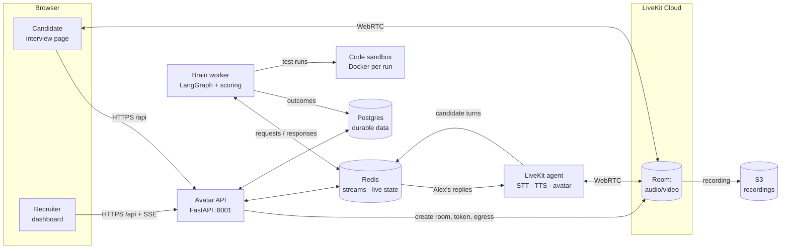
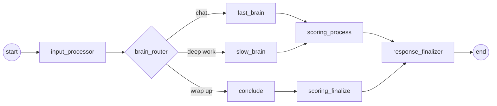

# Alex: project guide

Everything about the project in one place: what it does, how each piece works,
how they talk to each other, where data lives, how to run and deploy it, and
what is still open. Other docs go deeper on single topics (see
[Docs index](#16-docs-index)).

*Written 2026-11-02, at commit `a288911` on branch `launch/phase-2`.*

---

## Contents

1. [What Alex is](#1-what-alex-is)
2. [Current status](#2-current-status)
3. [Repository map](#3-repository-map)
4. [Architecture](#4-architecture)
5. [The life of an interview](#5-the-life-of-an-interview)
6. [Frontend](#6-frontend)
7. [Avatar service: API and LiveKit agent](#7-avatar-service-api-and-livekit-agent)
8. [Brain worker](#8-brain-worker)
9. [Messaging between services](#9-messaging-between-services)
10. [Data: Postgres and Redis](#10-data-postgres-and-redis)
11. [Security model](#11-security-model)
12. [API reference](#12-api-reference)
13. [Configuration](#13-configuration)
14. [Running, testing, deploying](#14-running-testing-deploying)
15. [External services](#15-external-services)
16. [Docs index](#16-docs-index)
17. [Known issues and what's next](#17-known-issues-and-whats-next)

---

## 1. What Alex is

Alex is an AI interviewer for first-round job screening. A candidate opens an
invite link and talks, by voice and video, to a realistic avatar called "Alex".
Alex asks questions that fit the job, follows up on the answers, and can run a
live coding round. While the interview happens, a scoring engine turns the
conversation into evidence-backed skill scores. Recruiters watch sessions live
or afterwards on a dashboard, and compare candidates for the same role with Elo
rankings.

Two interview modes (set on the invite):

| Mode | What happens |
|---|---|
| `round1` | Conversational interview about the candidate's experience, driven by the job's skill ladders |
| `round2_dsa` | Coding round: a problem statement, a code editor, and test runs in a sandbox, with Alex discussing the approach |

The main ideas:

- **Binary skill ladders.** Each skill from the job description gets 5 levels
  (awareness → mastery), each with a yes/no question. Scores come from which
  levels the candidate showed, not from a model's overall impression.
- **Cited evidence.** Every level reached has a quote from the transcript behind it.
- **Skill transfer.** Strength in a related skill can partly count toward a missing one.
- **Elo rankings.** Candidates for the same role are compared skill by skill.
- **Two "brains".** A fast brain answers in conversation in real time. A slow brain does
  heavier work: profile crawling, claim verification, reports.

---

## 2. Current status

| Area | Status |
|---|---|
| Runs locally | ✅ Host processes or `docker compose up` |
| Tests | ✅ worker 72, avatar 43, run in CI on every push |
| Accounts and access control | ✅ Organizations, users, roles, single-use invites |
| Durable data | ✅ Postgres (accounts, roles, invites, interviews, reports, audit log) |
| Code sandbox | ✅ Docker per test case (no network, limits), gVisor in production |
| Containers and health checks | ✅ 4 images, compose stack, readiness checks, graceful shutdown |
| AWS deployment | ⏸ Terraform + CD written and tested locally. **Blocked:** the AWS account is on the Free plan, which denies the needed services (see §17) |
| Monitoring and alerting | ⏭ Phase 4 |
| Privacy and compliance (consent, retention, deletion) | ⏭ Phase 6 |

The launch plan has phases 0–9 (`context/PRODUCTION_LAUNCH_PROMPT.md`). Phases 0–3 are done
except for owner steps. Each change is recorded in `context/LAUNCH_LOG.md`.

---

## 3. Repository map

```
Alex/
├── frontend/               React + Vite + TypeScript app (candidate and recruiter UI)
│   ├── src/pages/          InterviewPage, DSAInterviewPage, LoginPage, dashboard/*
│   ├── src/components/     CallSetup, InterviewRoom, ProblemStatement, TestResultsPanel, dashboard/*
│   ├── src/hooks/          useAuth, useInterviewCall, useProctoring, useOpsSSE, useSessionSSE
│   ├── src/services/       API clients (api, authApi, adminApi, dsaApi, eloApi, proctoringApi, roleApi)
│   ├── nginx/              production nginx config (security headers, /api proxy)
│   └── Dockerfile
├── avatar/                 Python service: HTTP API + LiveKit voice agent
│   ├── main.py             FastAPI app (API entry point)
│   ├── agents/entrypoint.py  LiveKit agent (voice loop)
│   ├── api/                routes: auth, calls, admin, roles, dsa, elo, proctoring, resumes
│   ├── core/               config, auth, db, redis, rate limits, interviews, recordings, roles
│   ├── services/           LiveKit control, streams, live calls, OCR, ...
│   ├── scripts/create_user.py
│   ├── tests/
│   └── Dockerfile          two targets: api, agent
├── worker/                 Python service: the "brain" (LangGraph) + scoring + sandbox
│   ├── worker.py           entry point (stream consumer loop)
│   ├── brain/              graph, processor, brains (router, fast, slow), tools, state
│   ├── scoring/            JD parser, ladders, evidence, tree, questions, score, Elo
│   ├── dsa/                coding-round models, problem store, interviewer engine, seed problems
│   ├── sandbox/            executor (docker/subprocess), selfcheck
│   ├── services/           streams, state manager, registry, metrics, interview store
│   ├── core/               config, redis, db, readiness, prompt safety, Hume client, llm_text
│   ├── scripts/backfill_outcomes.py
│   ├── tests/
│   └── Dockerfile
├── shared/alex_db/         shared Postgres package: models, sessions, migrations (Alembic)
├── deploy/                 server-side production deploy (compose files, Caddyfile, deploy.sh)
├── infra/terraform/        AWS infrastructure (bootstrap, modules/stack, envs/staging|production)
├── scripts/                backup_postgres.sh, aws/deploy-release.sh, aws/put-secrets.sh
├── docker-compose.yml      full local stack in containers
├── mprocs.yaml             run the four host processes with one command
├── .github/workflows/      ci.yml (tests, builds, audits), deploy.yml (CD to AWS)
├── docs/                   this guide, DEPLOY, AWS_SETUP, BACKUPS, SECRETS
└── context/                launch prompt and launch log
```

---

## 4. Architecture



| Component | Runs | Role |
|---|---|---|
| **Frontend** | Browser (served by nginx in production) | Candidate interview UI, coding round, recruiter dashboard |
| **Avatar API** | `avatar/main.py` (uvicorn, port 8001) | Accounts, invites, calls, roles, sessions, recordings, live events (SSE) |
| **LiveKit agent** | `python -m agents.entrypoint` | Joins each interview room: speech-to-text, turn detection, text-to-speech, avatar video |
| **Brain worker** | `worker/worker.py` | Decides what Alex says next, scores answers, runs code, writes reports |
| **Redis** | | Message streams between agent/API and worker; live session state; locks |
| **Postgres** | | Accounts, roles, invites, interview records, final reports, audit log |
| **LiveKit Cloud** | External | Real-time media (WebRTC), recording (egress) |

The services share nothing but Redis and Postgres. Each one can be restarted or scaled on its own.

---

## 5. The life of an interview

1. **Recruiter sets up a role.** Sign in → **Roles** → create a role with a job description
   (`job_roles` table). The worker turns the description into weighted skills and 5-level
   ladders the first time it's needed.
2. **Recruiter invites a candidate.** **Invites** → candidate name/email, role, mode
   (`round1` / `round2_dsa`), expiry → a signed, single-use link `…/interview?invite=<token>`.
3. **Candidate opens the link.** The page looks up the invite (`POST /auth/invites/lookup`),
   asks for camera and microphone, and optionally takes a resume upload (OCR → text).
4. **Call starts** (`POST /calls/`, with the invite token):
   - The invite is consumed atomically. It can't be used twice.
   - An `interviews` row is created (status `created`), and the candidate gets a short-lived
     cookie (`alex_candidate`) for this one interview.
   - The API creates the LiveKit room and token, starts recording if storage is set up, and
     stores the live call in Redis (`call:{id}`).
5. **The agent joins** the room. It starts the Beyond Presence avatar (its video is what the
   candidate sees), Deepgram for speech-to-text and Cartesia for the voice.
6. **Each candidate turn:**
   1. Deepgram transcribes. LiveKit's turn detector decides when the candidate has finished.
   2. The agent's `TurnRelay` publishes the turn to the Redis stream `interview:requests`,
      numbered with `turn_seq`.
   3. A worker takes it (consumer group `brain-workers`), locks the session, and runs the
      LangGraph graph (§8).
   4. The fast brain's reply is published to `interview:responses` *before* scoring finishes,
      tagged `reply_to_seq`, so Alex doesn't wait for scoring.
   5. The agent reads replies for its own session only, drops any reply to a turn the
      candidate has already talked past, and speaks it.
   6. Scoring updates the skill tree, and the dashboard gets live updates over SSE.
7. **Proctoring runs in the candidate's browser.** Face detection (BlazeFace) and object
   detection, such as a phone in view, report flags to the API, which queues them for the
   worker to add to the session's integrity record.
8. **Coding round (`round2_dsa`).** The page shows the problem and an editor. Code snapshots
   and runs go to the worker. Each test case runs in a throwaway sandbox container, and the
   result is shown to the candidate and discussed by Alex. The sandbox result is the source of
   truth; the model may not contradict it.
9. **The interview ends** (the candidate hangs up, `DELETE /calls/{id}`, or Alex concludes):
   - The live call is removed from Redis atomically, so ending twice is safe.
   - The interview row is updated, and recording stops.
   - The worker's `conclude` → `scoring_finalize` steps compute the final weighted score,
     update the role's Elo rankings, and save the report, scores, skill tree, transcript and
     integrity data to the `interviews` row.
10. **Recruiter reviews.** Session view: transcript, timeline, skill tree, radar chart, claim
    feed, integrity flags, the recording (a 15-minute signed link, and every view is audited),
    and the Elo ranking among candidates for the role.

---

## 6. Frontend

React 18 + TypeScript + Vite + Tailwind, in `frontend/`. The app calls the API through
relative `/api/...` URLs. The Vite dev server proxies `/api` to `localhost:8001`; in
production nginx does the same. Frontend and API therefore share one origin, which the
`SameSite=Strict` session cookie needs.

| Route | Page | Who |
|---|---|---|
| `/login` | Sign in / sign up | Recruiters |
| `/interview?invite=…` | Interview: setup, call room, proctoring | Candidates |
| (inside the interview) | Coding round: problem, Monaco editor, test results | Candidates |
| `/dashboard/ops` | Operations: live sessions, workers, stream throughput (platform admins see more) | Signed in |
| `/dashboard/invites` | Create and list invite links | Recruiters |
| `/dashboard/roles` | Job roles and descriptions | Recruiters |
| `/dashboard/rankings` | Elo rankings per role | Recruiters |
| `/dashboard/session/:id` | One interview: live or replay | Recruiters |
| `/dashboard/team` | Organization members | Org admins |

**Key hooks:**
- `useAuth`: session state, `RequireAuth` guard.
- `useInterviewCall`: call lifecycle.
- `useProctoring`: BlazeFace + object detection with TensorFlow.js, in the browser.
- `useSessionSSE` / `useOpsSSE`: live event streams.

The code editor (Monaco) loads from `cdn.jsdelivr.net`, pinned to version 0.57.0.

---

## 7. Avatar service: API and LiveKit agent

One Python package (`avatar/`) with two entry points, built into two images from one Dockerfile.

### 7.1 HTTP API (`main.py`)

FastAPI app with these route groups (full list in §12):

| Module | Does |
|---|---|
| `api/auth_routes.py` | Sign-up, login/logout, `/auth/me`, members, invites |
| `api/call_routes.py` | Start/end calls, call status, recordings, coding-round code runs and results |
| `api/role_routes.py` | Job roles (Postgres) |
| `api/admin_routes.py` | Sessions, live events (SSE), workers, ops stats, dead letters, demo controls |
| `api/dsa_routes.py` | Coding problem library (uses the worker's `dsa` models) |
| `api/elo_routes.py` | Rankings, comparisons, skill trees |
| `api/proctoring_routes.py` | Integrity flags and reports |
| `api/routes.py` | Resume upload (PDF/image → OCR text, 5 MB max) |

Supporting modules:
- `core/auth.py`: passwords, cookies, invites, permission checks.
- `core/rate_limit.py`: Redis-backed rate limits; the client IP comes through trusted proxies.
- `core/recordings.py`: signed links.
- `services/active_calls.py`: live calls in Redis.
- `services/ocr.py`: tesseract + pdf2image.

`GET /health` is liveness. `GET /ready` checks Redis and Postgres and returns 503 if either is down.

### 7.2 LiveKit agent (`agents/entrypoint.py`)

One job per interview room:

| Piece | Choice |
|---|---|
| Speech-to-text | Deepgram `nova-2`, English |
| Text-to-speech | Cartesia `sonic-2` |
| Voice activity | Silero VAD (loaded once per process) |
| Noise cancellation | LiveKit BVC |
| Avatar | Beyond Presence (`BEY_AVATAR_ID`) |
| End of turn | LiveKit turn detector; endpointing 0.5–3.0 s |
| Interruptions | Candidate must speak ≥ 0.8 s and ≥ 2 words to cut Alex off; false interruptions resume after 1 s |

**What the agent does:**
- `BrainRelayAgent` doesn't generate replies itself. It hands every completed turn to
  `TurnRelay`, which publishes it to Redis.
- A listener task reads `interview:responses` for this session, starting from where Alex last
  spoke (`avatar:last_spoken:{sid}`), drops stale replies, and speaks the rest.

**Running it:**
- **Development:** `python -m agents.entrypoint dev`.
- **Production:** `… start`. On SIGTERM it stops taking new interviews and waits up to
  `AGENT_DRAIN_TIMEOUT_SECONDS` (3600) for running ones to finish. Its health check is
  `GET :8081/`.

---

## 8. Brain worker

`worker/worker.py` reads `interview:requests` as part of consumer group `brain-workers`. For
each message, `brain/processor.py` loads the session state from Redis, takes the session
lock, and runs the graph or a special handler.

### 8.1 Special message types

Handled outside the graph:

| `message_type` | Does |
|---|---|
| `dsa_init` | Start a coding round with a problem |
| `dsa_code_snapshot` | Save the candidate's current code |
| `dsa_code_execute` | Run the code against test cases in the sandbox |
| `proctoring_flags` | Add integrity flags to the session (under the lock) |
| `slow_task_trigger` | Run pending slow work (e.g. Hume voice analysis) |
| `end_call` | The call ended |

Anything else is a conversation turn and goes through the graph.

### 8.2 The interview graph (LangGraph)



| Node | Does |
|---|---|
| `input_processor` | Cleans the turn, merges background verification results, checks for prompt injection |
| `brain_router` | Picks fast / slow / end: a regex pre-filter first, then a Gemini router when unsure (cached 5 min) |
| `fast_brain` | Understand → maybe use tools (`conversation`, `tavily_search`, `timestamp_noter`) → reply. The reply is published immediately |
| `slow_brain` | `profile_crawler` (GitHub, LinkedIn via Proxycurl, resume), claim verification, descriptive and analytics reports |
| `scoring_process` | Evidence extraction → skill tree update → next question choice |
| `conclude` / `scoring_finalize` | Final weighted score, Elo update, report saved to Postgres |
| `response_finalizer` | Final state and response |

Claim verification runs in the background (`brain/services/background_verifier.py`): results
are stored in `verified_results:{session_id}` and merged in on the next turn, so the reply is
never delayed.

**Models:**
- Main model: `GEMINI_MODEL` (default `gemini-3.8-flash`). `brain/models/llm_pool.py` falls back
  to other Gemini models on errors and rate limits.
- Scoring modules call Gemini through `langchain-google-genai`. Replies go through
  `core/llm_text.message_text()`, because current Gemini models return a list of content blocks
  rather than a string.

### 8.3 Scoring engine (`scoring/`)

```
Job description → JD parser → weighted skills
                → ladder generator → 5 binary levels per skill
Candidate answer → evidence extractor → (answer, quote, confidence)
                 → tree manager → candidate skill tree
                 → question selector → next skill/level to probe
Interview end → score calculator → weighted score → Elo system → rankings
```

- **Weighted score:** sum over skills of `(effective_level / 5) × weight`. The effective level is
  the achieved level plus any skill-transfer boost from a related skill, capped at 5. Evidence
  is accepted above a confidence threshold of 0.7.
- **Elo:** starts at 1500, K-factor 32, skill-by-skill comparisons. Rankings show from 2
  candidates per role.
- Skill ladders, Elo ratings and per-role candidate lists live in Redis (§10.2).

### 8.4 Coding round (`dsa/`, `sandbox/`)

- **Problems:** `dsa/seed_problems.py` loads the problem library into Redis
  (`dsa/problem_store.py`). Admins manage it through `/admin/dsa/problems`. The candidate only
  sees the public version, without hidden tests.
- **The interviewer:** `dsa/interviewer_engine.py` and `brain/tools/fast/dsa_conversation.py`
  guide the discussion: hints and complexity questions, without giving away the answer.
- **The sandbox:** `sandbox/executor.py` runs each test case in its own container:
  - **Isolation:** `--network none`, read-only root, user `nobody`, all capabilities dropped,
    `no-new-privileges`.
  - **Limits:** memory (no swap), CPU, process count, open files, file size, and a wall-clock
    timeout.
  - **Code delivery:** code arrives on stdin, and output is capped. Runtime is measured inside
    the container.
  - **Modes:** `SANDBOX_MODE=docker` is required in production, and the image must be pinned by
    digest there. `subprocess` is for development only and is not isolated.
  - **Self-check:** `python -m sandbox.selfcheck` checks that the sandbox works and that its
    code can't reach the network.

### 8.5 Reliability

- **Session lock:** `lock:session:{sid}`, renewed during long runs, so two workers never
  process one session at once.
- **Unacknowledged messages:** reclaimed periodically by other workers. A keepalive stops
  in-flight messages from being stolen. After `MAX_DELIVERY_ATTEMPTS` failures a message goes
  to the dead-letter stream `interview:dead`, which platform admins can list.
- **Shutdown:** on SIGTERM the worker finishes its current message, then exits.
- **Readiness:** the worker touches a readiness file on every heartbeat;
  `python -m core.readiness` is its health check.

---

## 9. Messaging between services

| Stream | Producer → consumer | Notes |
|---|---|---|
| `interview:requests` | Agent, API → worker | Consumer group `brain-workers`; each message handled by one worker |
| `interview:responses` | Worker → agent, API | Read with plain `XREAD`, filtered by `session_id`; replies carry `reply_to_seq` |
| `interview:dead` | Worker → (admins) | Messages given up on, with error and payload |

All streams are trimmed to about 100,000 entries (`STREAM_MAXLEN`).

**Live events to the dashboard (SSE).** The API streams typed events:
- `message`, `state_update`, `brain_mode`
- `score_update`, `skill_tree_update`
- `claim_detected`, `claim_verified`, `trust_update`
- `cheat_detected`, `integrity_update`
- `interview_ended`
- Ops view: `worker_joined` / `worker_left` / `worker_status`, `queue_depth`, `throughput`

---

## 10. Data: Postgres and Redis

### 10.1 Postgres (durable)

Shared package `shared/alex_db`: SQLAlchemy 2 (async, asyncpg) with Alembic migrations.
- **Development:** services apply migrations themselves.
- **Production:** they refuse to start on an out-of-date schema; migrating is a deploy step
  (`python -m alex_db.migrate`).

| Table | Holds |
|---|---|
| `organizations` | Customer organizations |
| `users` | Recruiters: email, name, scrypt password hash, role (`admin`/`recruiter`), platform-admin flag |
| `job_roles` | Roles and job descriptions, per organization |
| `invites` | Invite links: candidate, role, mode, coding problem, expiry, used-by session |
| `interviews` | One row per interview: status, timestamps, end reason, recording key, plus final `report`, `analytics`, `scores`, `skill_tree`, `dsa_state`, `integrity`, `transcript` (JSON) |
| `audit_log` | Security-relevant actions: who, what, target, IP |
| `consent_records` | Table exists for candidate consent; not used yet (Phase 6) |

Backups: `scripts/backup_postgres.sh` and [BACKUPS.md](BACKUPS.md). A restore drill has passed.

### 10.2 Redis (live state and queues)

| Key | Holds |
|---|---|
| `context:{session_id}` | Full live interview state (the worker's graph state) |
| `lock:session:{session_id}` | Session lock |
| `call:{call_id}`, `call_session:{session_id}`, `call_ended:{call_id}` | Live calls (12 h expiry) |
| `avatar:last_spoken:{session_id}` | Last reply the agent spoke |
| `verified_results:{session_id}`, `verification_lock:{session_id}` | Background claim verification |
| `elo_rating:{role}:{candidate}`, `weighted_score:{role}:{candidate}`, `role_candidates:{role}` | Elo and rankings |
| DSA problem keys | The coding problem library |
| `worker:heartbeat:*`, `worker:metrics:*`, `ops:throughput` | Worker registry and metrics |
| `stream:failed_attempts:*` | Failure counts per message |
| `ratelimit:*` | Rate-limit counters |
| `demo:cancelled_sessions` | Demo controls |

Redis holds data that matters (Elo ratings, the problem library), so it runs with AOF
persistence and a password.

---

## 11. Security model

| Area | How |
|---|---|
| **Recruiter auth** | Email + password (scrypt). Session in an HttpOnly, `SameSite=Strict` JWT cookie `alex_session` (12 h), `Secure` outside development. Login is rate-limited. Sign-up creates an organization; it is off in production unless `ALLOW_SIGNUP=true` |
| **Roles** | Organization `admin` / `recruiter`, plus a platform-admin flag (workers, ops, demo, dead letters). Every non-public route requires sign-in; a test sweeps all routes |
| **Candidates** | No account: a signed, single-use invite link → a short-lived cookie for that one interview (4 h). Can only reach their own session |
| **Org isolation** | Sessions, roles, invites and recordings are filtered by organization |
| **CORS** | Explicit origins only (`CORS_ORIGINS`) |
| **Browser** | HSTS, CSP, `X-Frame-Options: DENY`, nosniff, Referrer-Policy, Permissions-Policy (nginx) |
| **Code sandbox** | §8.4; on AWS, a separate server with gVisor, Docker API over mutual TLS |
| **Prompt safety** | `core/prompt_injection.py` / `prompt_firewall.py` check candidate input before it reaches the model |
| **Recordings** | Private bucket; viewers get a 15-minute signed link after an access check; every view is audited |
| **Secrets** | Never in git (`.gitignore` + gitleaks in CI); production values in AWS SSM Parameter Store ([SECRETS.md](SECRETS.md)) |
| **Production checks** | Services refuse to start without: a 32+ character `AUTH_SECRET`, a Redis password, `DATABASE_URL`, the API keys, Docker sandbox mode, and a digest-pinned sandbox image |
| **Audit log** | Sign-up, login (including failures), members, invites, calls, roles, recording views |

---

## 12. API reference

All paths are relative to the API; the frontend prefixes `/api`. 🔓 = public, 🎟 = the
candidate's interview cookie is also accepted (for their own session only), 👑 = platform admin.
Everything else needs a signed-in recruiter.

**Health:** `GET /health` 🔓 (liveness), `GET /ready` 🔓 (Redis + Postgres)

**Auth:** `GET /auth/config` 🔓 · `POST /auth/signup` 🔓 · `POST /auth/login` 🔓 ·
`POST /auth/logout` 🔓 · `GET /auth/me` · `GET|POST /auth/users` · `GET|POST /auth/invites` ·
`POST /auth/invites/lookup` 🔓

**Calls:**
- Lifecycle: `POST /calls/` (with an invite token) · `GET /calls/{call_id}` 🎟 · `DELETE /calls/{call_id}` 🎟
- Recordings: `GET /calls/recordings/{session_id}` (signed link)
- Coding round 🎟: `POST /calls/dsa/code_snapshot` · `POST /calls/dsa/execute` ·
  `GET /calls/dsa/result/{session_id}`

**Resumes:** `POST /resumes/upload` 🎟 (also with a still-valid invite token, for the setup
screen before the call)

**Roles:** `GET|POST /admin/roles/` · `GET|PUT|DELETE /admin/roles/{role_id}`

**Organization workspace** (`/org/*`, own organization only):
- Interviews: `GET /org/interviews` · `GET /org/interviews/{id}` (report page; platform admins
  may read any, with `internals`) · `PUT /org/interviews/{id}/decision` (advance / hold / reject)
- Invites: `POST /org/invites/{id}/revoke` · `POST /org/invites/{id}/link`
- Team (org admins): `PATCH|DELETE /org/users/{id}` · `POST /org/users/{id}/reset-password`

**Platform console** 👑 (`/platform/*`; 404 for everyone else):
- `GET /platform/health` · `GET /platform/organizations` · `GET /platform/organizations/{id}`
- `GET /platform/interviews` (`?include_unowned=true`) · `GET /platform/workers` · `GET /platform/queues`
  (streams and dead letters) · `GET /platform/audit` (filters: org, actor, action, dates; paged)
- Problem library: `GET|POST /platform/problems` · `GET|PUT|DELETE /platform/problems/{id}`

**Live sessions:** `GET /admin/sessions` (Redis state; the platform health page's live list)

**Demo controls** 👑: `POST /admin/demo/start` · `POST /admin/demo/stop` · `GET /admin/demo/status`

**Coding problems (read):** `GET /admin/dsa/problems/` (invite form) ·
`GET /admin/dsa/problems/{id}/public` (candidate's coding room). The old write routes on
`/admin/dsa/problems` remain; the console uses `/platform/problems`.

**Elo:**
- `GET /elo/roles` · `GET /elo/rankings/{role_id}`
- `GET /elo/candidates/{candidate_id}/role/{role_id}` · `GET /elo/compare/{role_id}/{a}/{b}`
- `GET /elo/interview-result/{session_id}` · `GET /elo/skill-tree/{session_id}` (`/detail`)

**Proctoring:** `POST /proctoring/flags` 🎟 · `POST /proctoring/flags/batch` 🎟 ·
`GET /proctoring/sessions/{id}/status` · `GET /proctoring/sessions/{id}/report`

Interactive docs: run the API and open http://localhost:8001/docs.

---

## 13. Configuration

Settings come from environment variables, or `.env` files in development. Complete,
commented lists: `avatar/.env.example` and `worker/.env.example`.

| Setting | Service | Purpose |
|---|---|---|
| `ENVIRONMENT` | both | `development` / `staging` / `production` (production enables strict checks) |
| `REDIS_URL` | both | Redis connection (password required in production) |
| `DATABASE_URL` | both | Postgres. Development defaults to the local container on port 5434 |
| `AUTH_SECRET` | avatar | Signs cookies and invites (32+ characters in production) |
| `CORS_ORIGINS`, `ALLOW_SIGNUP`, `ENABLE_DEMO`, `TRUSTED_PROXY_HOPS` | avatar | Web access settings |
| `LIVEKIT_URL`, `LIVEKIT_API_KEY`, `LIVEKIT_API_SECRET` | avatar | LiveKit project |
| `DEEPGRAM_API_KEY`, `CARTESIA_API_KEY`, `BEY_API_KEY`, `BEY_AVATAR_ID` | avatar | Speech and avatar |
| `S3_BUCKET`, `S3_REGION`, `S3_ACCESS_KEY`, `S3_SECRET_KEY`, `S3_ENDPOINT` | avatar | Recording storage |
| `AGENT_DRAIN_TIMEOUT_SECONDS`, `AGENT_HEALTH_PORT` | avatar | Agent shutdown and health |
| `GOOGLE_API_KEY` (or `GEMINI_API_KEY`), `GEMINI_MODEL` | worker | Gemini |
| `TAVILY_API_KEY`, `HUME_API_KEY`, `GITHUB_TOKEN`, `PROXYCURL_API_KEY`, `OPENAI_API_KEY` | worker | Optional tools |
| `SANDBOX_MODE`, `SANDBOX_IMAGE`, `SANDBOX_RUNTIME`, `SANDBOX_MEMORY_MB`, `SANDBOX_MAX_CONCURRENCY`, `DOCKER_HOST` | worker | Code sandbox |
| `MAX_DELIVERY_ATTEMPTS`, `RECLAIM_*`, `LOCK_TTL_MS` | worker | Stream reliability |
| `API_UPSTREAM`, `CSP_CONNECT_SRC` | frontend image | Where `/api` goes; extra CSP origins |

---

## 14. Running, testing, deploying

### Locally: host processes (development)

Prerequisites:
- Redis running locally.
- The `alex-postgres` container (Docker/Colima) on port 5434.
- Filled-in `avatar/.env` and `worker/.env`.

Then, each command in its own terminal tab (or all four at once with `mprocs`):

API:

```bash
cd avatar && uv run python main.py
```

LiveKit agent:

```bash
cd avatar && uv run python -m agents.entrypoint dev
```

Worker:

```bash
cd worker && uv run worker.py
```

Frontend:

```bash
cd frontend && npm run dev
```

Open http://localhost:3000. Create the first account at `/login`, or from the command line:

```bash
cd avatar && uv run python -m scripts.create_user --platform-admin
```

### Locally: everything in containers

```bash
docker compose up --build
```

Open http://localhost:8080. This runs its own Redis and Postgres, a migration step, the four
services, and a separate Docker daemon for the code sandbox. Don't run both setups at once
against one LiveKit project.

### Tests

Worker:

```bash
cd worker && uv run pytest -q
```

Avatar:

```bash
cd avatar && uv run pytest -q
```

Frontend (typecheck + build):

```bash
cd frontend && npm run build
```

- **Test databases:** Redis db 15 and the `alex_test` Postgres database. Tests skip if these
  aren't reachable.
- **Docker sandbox tests:** run only when Docker and the sandbox image are present.

### CI (`.github/workflows/ci.yml`, on every push and pull request)

- Lint and tests for both services, against real Redis and Postgres.
- Frontend typecheck and build.
- Builds of all four images; compose file validation.
- Terraform format/validate and shellcheck.
- Secret scan (gitleaks).
- Dependency audit (report only).

### Deployment

- **Images** (all non-root, pinned base images, health checks, from the repo root): `api` and
  `agent` (`avatar/Dockerfile`), `worker`, `frontend` (nginx). See [DEPLOY.md](DEPLOY.md).
- **AWS pilot layout** (Mumbai, `infra/terraform`):
  - One app server running `deploy/docker-compose.prod.yml`: Caddy for automatic HTTPS,
    frontend, API, worker, Redis, and one agent per release.
  - A separate sandbox server: Docker + gVisor, mutual TLS.
  - RDS Postgres, S3 buckets, ECR image registry.
  - Settings in SSM Parameter Store; no SSH (SSM Session Manager instead).
- **CD (`deploy.yml`):**
  - A push to `main` builds images and deploys to staging.
  - Production and rollbacks: a manual run with a commit SHA.
  - `deploy/deploy.sh` checks health, readiness and the sandbox self-check, and rolls back
    automatically on failure. The new agent starts before the old one drains.
  - The workflow is skipped until `AWS_DEPLOY_ROLE_ARN` is set.
- **Setup steps:** [AWS_SETUP.md](AWS_SETUP.md).

---

## 15. External services

| Service | Used for | Needed |
|---|---|---|
| LiveKit Cloud | Real-time audio/video rooms, recording | Yes |
| Deepgram | Speech-to-text | Yes |
| Cartesia | Text-to-speech (Alex's voice) | Yes |
| Beyond Presence | Avatar video | Yes |
| Google Gemini | All reasoning and scoring | Yes |
| Tavily | Web search during interviews | Optional |
| Hume AI | Voice emotion analysis | Optional |
| GitHub API / Proxycurl | Profile crawling (GitHub, LinkedIn) | Optional |
| S3 (or compatible) | Recordings | Optional (recording off without it) |
| jsDelivr CDN | Code editor (Monaco) | Yes, for the coding round |

These are billed per use. Each environment (dev, staging, production) should have its own keys
and LiveKit project.

---

## 16. Docs index

| File | What |
|---|---|
| `README.md` | Overview and quick start |
| `docs/PROJECT_GUIDE.md` | This guide |
| `docs/DEPLOY.md` | Images, health checks, production requirements |
| `docs/AWS_SETUP.md` | Step-by-step AWS setup |
| `docs/BACKUPS.md` | Backup and restore, drill log |
| `docs/SECRETS.md` | Secret inventory and rotation |
| `context/PRODUCTION_LAUNCH_PROMPT.md` | The full launch plan (phases 0–9) |
| `context/LAUNCH_LOG.md` | Every change made, phase by phase, with how it was verified |

---

## 17. Known issues and what's next

### Needs the owner

- **Leaked Gemini key.** It's in git history (commit `d77e1c8`). Revoke it and use a new key.
- **AWS is blocked by the Free plan.** The account is in an AWS-managed organization whose
  policies deny S3 buckets, ECR and the GitHub OIDC provider. Nothing was created. Upgrading to
  the Paid plan fixes it; the remaining credits ($120 at the time of writing) still apply. Or
  run locally / on another host for now.
- **Live interview test.** Many dependencies were upgraded, and the scoring fix landed after the
  last full interview, so run one complete voice interview before relying on it.

### Open technical items

- **Frontend dependencies:**
  - Vite 5 → 8 upgrade (dev-server advisories only).
  - ESLint setup.
  - Two DOMPurify advisories inside the Monaco editor, waiting for a Monaco release.
- **Data still only in Redis:** the coding problem library and Elo ratings (covered by AOF;
  candidates to move to Postgres).
- **Single-server pilot limits:** a deploy restarts the API (about 10 s of errors); Redis lives
  on the app server.
- `consent_records` isn't wired up yet.
- **Import order:** importing `scoring` before `brain` causes a circular import. The worker
  always imports `brain` first.

### Remaining launch phases

| Phase | Covers |
|---|---|
| 4 Observability | Structured logs, metrics, tracing, alerts (dead letters, errors, latency, cost) |
| 5 Reliability and quality | Load tests, latency budget, failure drills, image size |
| 6 Privacy and compliance | Consent, retention, deletion, data export, privacy notice |
| 7 Product completeness | What paying customers need (billing, onboarding, settings) |
| 8 Testing and QA | End-to-end tests, test plan, security review |
| 9 Launch | Go-live checklist, on-call, support |
